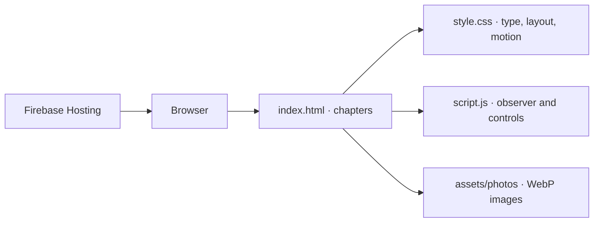

# Naomi Rouli

**A nine-chapter editorial website built with photography, typography, and small, deliberate interactions.**

A personal story told through one scrolling document. Instead of a component framework or a generic portfolio template, the site uses semantic HTML, a restrained CSS system, and a small JavaScript layer for chapter tracking, gallery movement, and an interactive letter.

[Visit the website](https://naomirouli.web.app) · [View source](https://github.com/zvenians/naomirouli)

[](https://github.com/zvenians/naomirouli/actions/workflows/static-site.yml)

---

## Concept

The project is organized like a short editorial publication. Each chapter changes the balance of photography and text while preserving a continuous reading experience. The content is personal; the technical work is in the page structure, image presentation, touch/keyboard behavior, and restrained motion.

The goal is not to reproduce a magazine template. It is to create a small publication with a clear beginning, a navigable middle, and a deliberate ending.

## Reading sequence

| Chapter | Section | Presentation |
| --- | --- | --- |
| **01** | Opening | Full-width portrait and introductory headline |
| **02** | A name | Paired typography and portrait |
| **03** | Her | Short details and character portrait |
| **04** | Little things | Editorial cards with images and captions |
| **05** | Little archive | Horizontally browsable photo collection |
| **06** | How it started | Narrative text and supporting imagery |
| **07** | The date | Personal milestone presented as a graphic element |
| **08** | Private note | On-demand letter panel and close control |
| **09** | Closing | Final message and credits |

The section labels are navigational content, not separate routes. The site is intentionally maintained as one document.

## Interaction details

### Chapter awareness

An `IntersectionObserver` observes the page sections and updates the current chapter display when the reader progresses. This keeps the top-bar indicator linked to the document rather than a fixed animation timeline.

### Photo archive

The horizontal photo rail uses pointer events for desktop dragging. Touch interaction is handled through the browser's native input behavior; desktop drag handling avoids capturing touch pointers.

### Letter panel

The letter control opens a distinct note panel, moves keyboard focus to its close control, and restores focus when closed. The Escape key also closes the panel. These behaviors are covered by the browser smoke tests.

### Motion and accessibility

The CSS includes visible keyboard focus styles and honors `prefers-reduced-motion`. Secondary text on light sections uses deliberate contrast values. Reduced-motion support does not mean all possible combinations of devices and assistive technology have been certified.

## Implementation



| Responsibility | Implementation |
| --- | --- |
| Structure | HTML5 sections, headings, images, controls |
| Design | CSS custom properties, responsive layouts, editorial typography |
| Interaction | Vanilla JavaScript, IntersectionObserver, Pointer Events |
| Photography | Local `.webp` assets |
| Hosting | Firebase Hosting |
| Quality checks | Node.js static tests and Chromium smoke checks |

No JavaScript framework, runtime database, or user account system is required to render this site.

## Repository structure

```text
.
├── index.html                     Nine editorial chapters
├── style.css                      Color, typography, layout, responsive rules
├── script.js                      Chapter observer, rail, and letter controls
├── assets/photos/                 Image assets
├── tests/
│   ├── static-site.test.mjs       Structure, links, and local asset checks
│   └── browser-smoke.mjs          Desktop/mobile keyboard behavior
├── firebase.json                  Static hosting configuration
└── .firebaserc                    Firebase project selection
```

## Run locally

A static server is enough to preview the experience:

```bash
git clone https://github.com/zvenians/naomirouli.git
cd naomirouli
python -m http.server 8000
```

Open `http://localhost:8000`. Use an HTTP server rather than opening the file with a `file://` URL so resource paths behave consistently.

### Verification

```bash
node --check script.js
node --test tests/static-site.test.mjs
```

The GitHub Actions workflow also runs a headless Chromium smoke test with Playwright on narrow and desktop viewports, verifying opening/closing the letter and keyboard focus behavior.

For local browser verification:

```bash
npm install --no-save --no-package-lock playwright@1.62.1
npx playwright install chromium
node tests/browser-smoke.mjs
```

Node.js 24 is used by the current CI workflow. Use that version for consistent results.

## Editing guidance

- **Content changes:** update chapter text in `index.html`; maintain meaningful heading order and image descriptions.
- **Image changes:** add or replace appropriately optimized photographs under `assets/photos/`; verify cropping on phones and larger displays.
- **Layout changes:** prefer existing CSS variables and component classes over one-off inline overrides.
- **Interaction changes:** preserve keyboard and touch input; run the browser smoke test after changing the rail or letter.
- **Publication:** keep personal photographs and private text only with appropriate permission. Public repository access does not imply unrestricted reuse.

## Hosting and release

`firebase.json` serves the repository as a static site through the configured `naomirouli` Firebase Hosting site. An authorized maintainer may deploy with Firebase CLI, after review:

```bash
firebase deploy --only hosting
```

That command changes a live website; it is **not** part of ordinary testing. Publishing requires a deliberate release decision and the correct Firebase project selection.

### Browser-only GitHub Actions deployment

The `.github/workflows/firebase-hosting.yml` workflow can publish this static site from **GitHub.com in a browser**. It does not require the ChatGPT desktop application or a Firebase ChatGPT plugin.

**One-time authorization (repository owner):**

1. In the Google Cloud Console, select project `gmahk-galilea-archive` and create a dedicated service account for Firebase Hosting deployment to site `naomirouli`. Use the minimum roles required by the [official Firebase Hosting GitHub Action setup](https://github.com/FirebaseExtended/action-hosting-deploy/blob/main/docs/service-account.md).
2. If your organization permits JSON service-account keys, create a key and add its **entire JSON contents directly in GitHub** under **Settings → Secrets and variables → Actions → New repository secret**, named `FIREBASE_SERVICE_ACCOUNT_NAOMIROULI`. Never paste keys into a chat, source file, pull request, or build log. If key creation is disabled, use a supported short-lived identity setup instead of weakening policy.
3. Open **Actions → Firebase Hosting — Naomi Rouli → Run workflow → main**. This manually publishes the reviewed `main` to the Firebase Hosting **live** channel.
4. For automatic releases on future changes to the site, optionally add an Actions **repository variable** `FIREBASE_DEPLOY_ENABLED` set to `true`. Until then, pushes skip the deployment job; manual workflow dispatch remains available.

The workflow verifies the static site and configuration, checks for a configured secret, and deploys the existing `firebase.json` site `naomirouli` in project `gmahk-galilea-archive`. It does not affect the congregation's other Firebase Hosting sites. Check the Actions run and [`naomirouli.web.app`](https://naomirouli.web.app) after publication.

Hosting ignores `tests/` and repository documentation so those files are not included in a new public Hosting release.

## Scope

This is an editorial website, not a blogging platform or photo-sharing service. It does not provide accounts, uploads, analytics dashboards, or a content-management backend. Its value lies in a focused experience rather than feature volume.

---

**Personal content and photographs remain subject to their respective owners' rights.** Source maintained by [@zvenians](https://github.com/zvenians).
